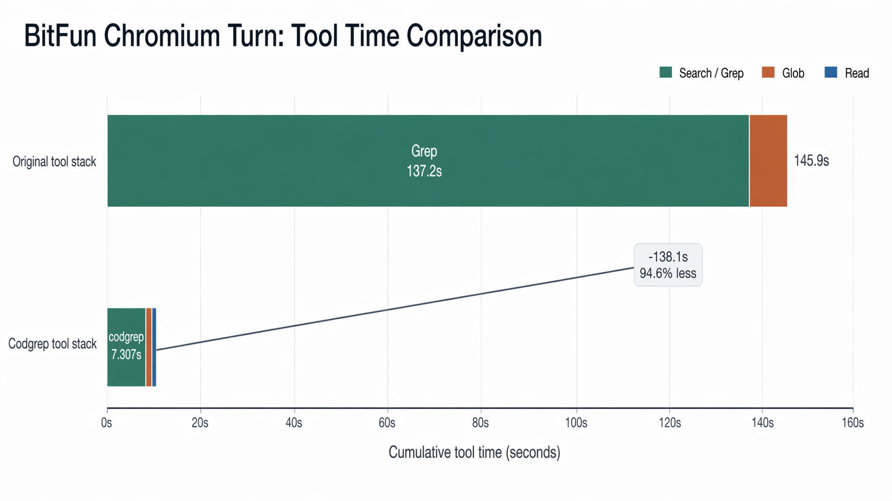
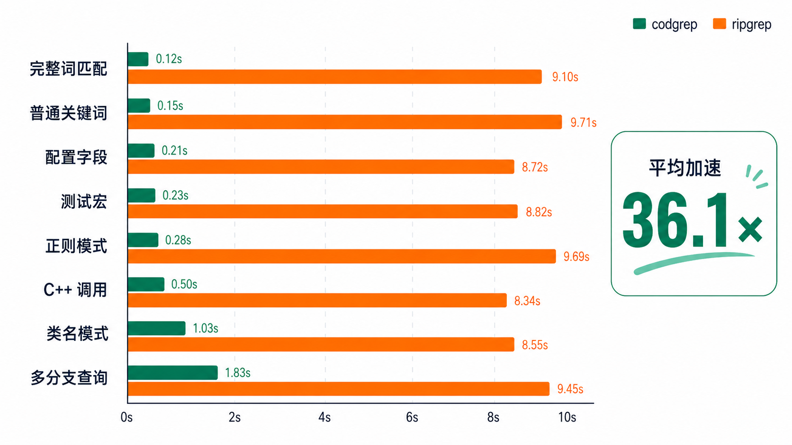

# FlashGrep

[](https://github.com/openBitFun/FlashGrep/actions/workflows/build-packages.yml)
[](https://www.rust-lang.org/)
[](LICENSE)

> **The indexed search engine for OpenBitFun.**
>
> FlashGrep turns repeated repository-wide `grep` and `glob` calls into an indexed, incremental search service for coding agents. It is designed for the moment when an agent should spend its time understanding code, not waiting for the next scan to finish.

FlashGrep is an open-source project in the [openBitFun](https://github.com/openBitFun) organization and the search engine used by [BitFun](https://github.com/GCWing/OpenBitFun). It provides a Rust daemon, a stable cross-process protocol, and an MCP server that can be embedded in an IDE, agent runtime, or desktop application.

<p align="center">
  
</p>

<p align="center"><em>Search the index first, then verify only the small set of relevant files.</em></p>

[中文](#中文) · [Architecture](#architecture) · [MCP integration](#mcp-integration)

## Why FlashGrep

Coding agents search much more often than a human developer. A single task may ask for symbols, call sites, configuration keys, tests, generated files, and several regular expressions in sequence. On a large repository, repeatedly scanning every file turns a capable agent into a process that spends most of its time waiting.

FlashGrep builds a repository index once, uses character-level inverted indexes to produce a conservative candidate set, and runs the exact regex verifier only on those candidates. The result is a search path that stays useful as the repository grows and as the same workspace is queried again and again.

### A real large-repository result

The benchmark that motivated this project was run on Chromium, a repository with nearly **60 million lines of code** and more than **4 GB of Git-tracked files**:

- indexed search reduced the search portion of a representative agent workflow from about **137.2 s to 7.82 s**;
- across a broader set of Chromium queries, FlashGrep averaged about **36.1×** the throughput of `ripgrep` in BitFun's internal comparison;
- the initial base index took about **79.0 s** to build and occupied about **2.5 GB**.

These figures describe the Chromium benchmark setup documented in the project materials. They are a reference point for the design, not a promise that every repository or query will see the same speedup. See [benchmark notes](docs/chromium_query_benchmark_2026-07-25.md) and [workspace results](docs/filesystem_workspace_results.md) for the measurement details.



<p align="center"><em>A representative workflow dropped from roughly 145.9 seconds to 7.82 seconds after indexed search replaced repeated grep and glob scans.</em></p>



<p align="center"><em>Across the documented Chromium query set, the internal comparison reports an average 36.1× speedup over ripgrep.</em></p>


## What it provides

- **Indexed literal and regex search** — sparse n-gram or trigram tokenization narrows candidates before exact verification.
- **Incremental workspaces** — file events, Git changes, branch switches, additions, edits, deletions, and restores are reconciled into published overlay segments.
- **Git and filesystem modes** — use Git snapshots when available, or index an ordinary directory with `--no-git`.
- **One daemon per workspace** — multiple clients share the same index reader, watcher, build tasks, and lifecycle.
- **Stable protocol** — integrate through `daemon::protocol` and `DaemonClient` / `ManagedDaemonClient` instead of coupling to internal index structures.
- **MCP server** — expose search, glob, status, refresh, and index-build tools to Claude Code, Codex, Cursor, Trae, and other MCP hosts.
- **Safe fallback behavior** — a repository can be searched while its first base index is building, and freshness can be selected explicitly when a caller needs reconciliation.

## Quick start

### Build from source

Requirements: Rust 1.85+ with Cargo, and Node.js 18+ if you want to use the MCP server.

```bash
git clone https://github.com/openBitFun/FlashGrep.git
cd FlashGrep
cargo build --release
```

### Start the daemon

```bash
# Start the repository search server.
./target/release/flashgrep serve --bind 127.0.0.1:4597

# Register a repository and start its index build.
./target/release/flashgrep daemon open --repo /path/to/repository
./target/release/flashgrep daemon build --repo-id /path/to/repository

# Search through the daemon protocol.
./target/release/flashgrep daemon search --repo-id /path/to/repository 'ManagedDaemonClient'

# Inspect status or ask for a path glob.
./target/release/flashgrep daemon status --repo-id /path/to/repository
./target/release/flashgrep daemon glob --repo-id /path/to/repository -g '*.rs' src
```

`build` is also available as a managed one-shot entry point. It starts or reuses the daemon, ensures the repository is registered, and returns while the base build can continue in the background:

```bash
./target/release/flashgrep build --repo /path/to/repository
```

For ordinary directories, or for a Git subdirectory that should have an independent filesystem index:

```bash
./target/release/flashgrep build --repo /path/to/directory --no-git
```

### Search freshness

The daemon and MCP APIs expose three freshness policies:

| Policy | Behavior |
| --- | --- |
| `published` | Query the last published base plus overlay while background maintenance continues. |
| `reconciled` | Reconcile the known workspace changes before querying; fail if publication fails. |
| `filesystem` | Scan the current files directly without updating the index. |

Use `reconciled` when a caller needs known changes published before the query, and `filesystem` when it needs a direct current-filesystem read. Neither direct scanning nor reconciliation is an atomic snapshot across concurrent edits.

## MCP integration

The `mcp/` directory contains the MCP server source, its documentation, and the FlashGrep agent skill. The server starts a lightweight bridge to the managed daemon and exposes five tools:

- `search_code` — indexed or transition search with regex, literal, count, and path-scope options;
- `glob_files` — enumerate files using the same ignore and scope rules;
- `repo_status` — inspect repository and workspace progress;
- `refresh_repo` — ask the watcher to reconcile known changes;
- `build_index` — start a missing base-index build without waiting for completion.

Run it directly from a checkout:

```bash
node mcp/server.js --repo /path/to/repository --daemon-bin /absolute/path/to/flashgrep
```

A minimal MCP configuration looks like this:

```json
{
  "mcpServers": {
    "flashgrep": {
      "command": "node",
      "args": [
        "/absolute/path/to/FlashGrep/mcp/server.js",
        "--repo",
        "/path/to/repository"
      ]
    }
  }
}
```

The full host-specific setup, release bundle layout, tool schemas, and option reference are in [`mcp/README.md`](mcp/README.md).

## Architecture

FlashGrep has a clear split between the stable integration surface and the index implementation:

```text
MCP / IDE / agent runtime
            │
            ▼
     daemon protocol
            │
     managed daemon
       ┌────┴────┐
       │         │
 base snapshot  workspace overlay
       │         │
       └────┬────┘
            ▼
   indexed candidate retrieval
            │
            ▼
      exact regex verification
```

The main components are:

- `src/daemon/` — server lifecycle, repository sessions, watcher, status, protocol, and managed-client coordination.
- `src/index_engine/` — manifests, segments, posting lists, deletes, readers, merge policy, base snapshots, and overlays.
- `src/query_runtime/` and `src/planner.rs` — query normalization, conservative token extraction, candidate execution, and result limits.
- `src/files.rs`, `src/git_snapshot.rs`, and `src/worktree_diff.rs` — repository discovery, ignore rules, Git snapshots, and worktree changes.
- `mcp/` — the Node MCP server and the reusable FlashGrep agent skill.

The on-disk index normally lives under `.flashgrep-index-engine/` and is separate from the source tree. A base snapshot is immutable after publication; workspace overlays contain published changes. A query therefore reads a consistent `base + overlay` view while background tasks build, merge, reclaim, or recover newer layers.

The stable external contract is the daemon protocol described in [`docs/daemon_protocol.md`](docs/daemon_protocol.md). Rust library modules outside that protocol remain useful for tests, benchmarks, and expert integrations, but they are intentionally not the primary compatibility surface.

## Benchmarks and experiments

The repository includes benchmark runners and reproducible notes for large repositories, dirty worktrees, cold and warm cache behavior, and watcher experiments.

```bash
# Run a named suite and compare with ripgrep.
cargo run --release --bin flashgrep -- bench \
  --suite-dir /path/to/bench_data \
  --filter linux_literal \
  --compare-rg \
  --rebuild

# Exercise a sampled dirty worktree.
cargo run --release --bin flashgrep -- bench \
  --suite-dir /path/to/bench_data \
  --filter linux_literal \
  --compare-worktree \
  --worktree-sample-files 32 \
  --rebuild
```

Benchmarks report index-build and query costs separately. `ripgrep` comparisons do not include any index-build time. The benchmark runner supports warm and cold cache modes, query traces, raw CSV output, and optional worktree sampling; see the [benchmark section](docs/chromium_query_benchmark_2026-07-25.md) before comparing numbers across machines.

## Development

Run the formatter, lints, and tests before sending a change:

```bash
cargo fmt --all -- --check
cargo clippy --all-targets --all-features
cargo test --all-targets --all-features
```

The project uses GitHub Actions to build release binaries for Linux, macOS, and Windows and to assemble the MCP distribution bundle. Push a version tag such as `v0.2.17` to publish release assets through the workflow in [`.github/workflows/build-packages.yml`](.github/workflows/build-packages.yml).

When changing execution paths, keep one clear primary path. Compatibility branches should exist only when they represent a real external constraint; the index engine and daemon are deliberately organized around a single published workspace view.

## Documentation map

- [Daemon protocol](docs/daemon_protocol.md) — request, response, notification, and lifecycle contract.
- [Index engine blueprint](docs/index_engine_blueprint.md) — storage and query design.
- [Incremental index design](docs/incremental_index_design.md) — base snapshots, overlays, and publication.
- [Workspace architecture](docs/workspace_index_architecture.md) — workspace view and freshness model.
- [Chromium benchmark notes](docs/chromium_query_benchmark_2026-07-25.md) — benchmark context and methodology.
- [Filesystem workspace results](docs/filesystem_workspace_results.md) — watcher, reconciliation, and performance validation.

## Contributing

Issues, benchmark reports, protocol improvements, and pull requests are welcome. If you are integrating FlashGrep into an agent or desktop product, start with the daemon protocol and include the repository shape, query mix, cache mode, and hardware when sharing performance results.

FlashGrep is maintained as part of the openBitFun open-source community. See the organization repositories and contribution guidance at [github.com/openBitFun](https://github.com/openBitFun).

## License

FlashGrep is released under the [MIT License](LICENSE). Third-party dependencies retain their respective licenses.

---

## 中文

FlashGrep 是 openBitFun 组织下的高性能代码检索引擎，也是 BitFun 用来加速大仓库代码搜索的基础设施。它把反复执行的 `grep` / `glob` 调用变成可复用的增量索引服务：先用字符级倒排索引快速缩小候选文件范围，再对候选文件执行精确的 regex 验证。

在 Chromium 这类接近 6000 万行代码、Git 跟踪文件超过 4 GB 的真实大仓库上，FlashGrep 的基础索引约 79 秒完成，索引大小约 2.5 GB；在 BitFun 内部的一组检索任务中，相比 `ripgrep` 平均约 36.1 倍加速。具体数据依赖仓库、查询集合、缓存状态和硬件，完整口径请看上面的 benchmark 文档。

它支持：

- Rust daemon 与稳定的跨进程 protocol；
- Git commit base、普通目录 filesystem base，以及工作区增量 overlay；
- 分支切换、文件新增/修改/删除/恢复和 watcher 事件的增量维护；
- MCP server，可接入 Claude Code、Codex、Cursor、Trae 等 MCP 宿主；
- `published`、`reconciled`、`filesystem` 三种查询新鲜度；
- Linux、macOS、Windows 的 release 构建和 MCP 分发包。

从源码构建和启动：

```bash
git clone https://github.com/openBitFun/FlashGrep.git
cd FlashGrep
cargo build --release
./target/release/flashgrep serve --bind 127.0.0.1:4597
./target/release/flashgrep daemon open --repo /path/to/repository
./target/release/flashgrep daemon build --repo-id /path/to/repository
./target/release/flashgrep daemon search --repo-id /path/to/repository 'ManagedDaemonClient'
```

如果要接入 MCP：

```bash
node mcp/server.js \
  --repo /path/to/repository \
  --daemon-bin /absolute/path/to/flashgrep
```

详细的 MCP 配置、daemon 协议、索引结构和 benchmark 说明见 [`mcp/README.md`](mcp/README.md)、[`docs/daemon_protocol.md`](docs/daemon_protocol.md) 和 [文档索引](#documentation-map)。欢迎在 [openBitFun](https://github.com/openBitFun) 组织下提交 issue、基准数据和改进。
