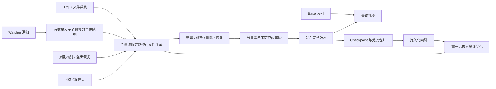

# 文件系统工作区架构

正式 daemon、managed client 和 MCP 以工作区文件系统为基础。普通目录、未提交的 Git 仓库和已有提交的 Git 仓库共用发现、增量发布、查询及恢复流程。Git 提供可选的根目录发现、tracked 成员信息、分支提示和 commit base 缓存；`--no-git` 关闭这些能力并保持指定目录范围。

## 发现与收录

Watcher 是变化线索，文件清单和实际读取结果决定收录内容。普通事件只扫描相关文件或目录；删除目录时也检查索引中该目录下的旧路径。初次打开、周期核对、队列溢出及忽略规则变化会触发全量核对。

初次构建、限定路径扫描和全量核对共享忽略、隐藏文件、大小、二进制探测及内部存储排除规则。符号链接及经过符号链接目录的路径不收录；Git tracked 信息不能豁免这些规则。Git base 构建与 commit 增量也排除自定义存储目录和内部路径。Git tracked 信息用于保留已有的 tracked/ignore 语义，普通编辑不调用 `git status` 或 `git diff`。

直接文件事件会要求内容核验，不能仅因元数据未变化而跳过更新。Unix 上的全量核对使用独立工作区观测表，以设备、inode、大小、mtime、ctime 判断内容指纹能否复用；其他平台重新读取内容。观测表不依赖 Git 或 base 版本，损坏时重新读取，完整扫描时清理并保存。最多四个独立发现线程执行核验。元数据快捷路径不等于对任意外部修改方式的绝对新鲜度保证；需要直接读取文件时使用 `filesystem` 查询模式。

## 发布与查询

增量包括新文档、替换文档、删除屏蔽和恢复到 base 的撤销记录。恢复某个文件只撤销该路径的增量，不重建其余脏文件。大批输入分批准备和暂存，完成一个发布批次后才替换查询视图。生产路径先发布内存段，再由独立持久化线程编码磁盘段、提交 manifest；无需等待磁盘完成才可查询。后台捕获的版本只推进自己的持久化序号，不覆盖期间发布的新修改，base 替换会使旧 checkpoint 失效。

查询持有完整的已发布视图。新构建的 Git 和普通目录 base 都在索引内保存不可变内容，增量层也保存自己的内容。Git base 按对象 ID 读取提交，而不是根据工作区是否干净决定内容来源。更新期间查询可以使用先前版本；新变化尚未发布时，不保证被默认查询看到。索引查询验证的是该版本内容，直接扫描模式读取当前文件。

落盘时，大于等于 4 KiB 且有压缩收益的内容使用 Zstd；可见内存段直接持有源码与共享 posting，不进行压缩或重复分词。基线查询按候选文档解码，不保留全量解码源码；增量层为重复查询共享 512 MiB 的解码内容准入预算，预算用尽后按需解码，缓存随不可变段的最后一个 reader 释放。它不是 LRU，也不是进程 RSS 上限：目录、posting、合并工作缓冲和查询持有的内容另计。文件名模式在第一处匹配后停止，`matched_lines` 统计已验证的首个命中；完整计数须使用计数模式。索引指纹升级为 `index-engine-postings-v4-inline-snapshots`，已有旧基线需要重建。

Base 的每次新发布有独立 manifest 身份，增量记录绑定的 base 身份。Base 任务与文件变化核对共用发现锁，防止正在规划增量时 base 被另一任务替换；显式核对可能等待该任务，默认查询仍可读取已发布视图。发现计划过期或 base/overlay 不匹配时，不能将旧增量当成新 base 的增量。进程内 reader lease 保护正在读取的历史段；GC 在读取 manifest 到登记 lease 的窗口也受协调。这里不声称跨进程并发 GC 的安全契约。

| 查询模式 | 行为 |
|---|---|
| `published` | 默认使用已发布索引；索引不可用或 Git 过渡时保留扫描行为。 |
| `reconciled` | 先核对并发布变化，再查询；失败返回调用方，构建期间直接扫描。 |
| `filesystem` | 按当前收录规则直接扫描文件，不更新索引。 |

扫描本身不是整个文件系统的原子快照。并发编辑可能跨越不同文件的读取时刻。

## 资源与后台调度

- 事件队列最多 16,384 项，路径传输及待处理候选分别有 8 MiB 字节预算；超限转为全量核对。
- 增量写入以 8 MiB 源内容或 1,024 操作为暂存刷新阈值，避免一次保留完整脏集的准备内容。单个文档不拆分，加入文档后触发刷新，因而可超出字节阈值一个文档。
- 内存暂存段对 store 持有的内容、posting 和元数据估算设置 256 MiB 预算；超过预算时先溢写旧段，单段超过预算直接写盘。删除记录单独限制为 65,536 条。查询持有的旧 reader 和构建瞬时内存不包含在此预算内。
- Overlay 合并输入预算为 64 MiB；单个旧版超大段仍允许独立处理，避免永远无法前进。
- 每个后台合并回合最多执行一个任务，发布后回收不再被 reader 持有的旧段，再调度后续任务。文件发现与持久化使用独立线程；checkpoint 的磁盘阶段释放发布锁，查询和新发布可以继续。合并仍在发布锁内执行一个有界任务；存在更新尚未提交时先推迟合并。
- 已处理的删除序号保存在段引用中。用于屏蔽 base 的删除记录可以保留，但不会反复触发同一合并。

这些是源内容和任务的预算，不是固定 RSS 上限。分词膨胀、posting、路径目录、缓存、运行时分配器及长查询持有的旧版本仍然占用内存。性能报告分别记录结果可见、后台合并空闲、峰值 RSS 和重启成本。

## 恢复与状态

重开先恢复持久化版本，再核对离线变化。默认查询可能先看到恢复出的旧版本；需要核对后查询时显式选择新鲜度模式。发布失败不会推进可见修订。后台持久化失败不会撤销已经可见的结果，也不会推进持久化序号；通过 maintenance 错误状态暴露并重试。正常关闭等待后台任务并 checkpoint；突然终止后先恢复最后持久化版本，再通过文件系统核对补回尚未落盘的修改。

`overlay.last_seq_no` 与 `overlay.committed_seq_no` 分别表示已接收写入与已提交序号；不能将 `published_revision` 当作磁盘持久化证明。旧的同步自动提交阈值参数 `overlay_auto_checkpoint_max_uncommitted_ops` 及对应 CLI 标志已删除；后台调度延迟仍由 `overlay_merge_min_delay_ms` 控制。

`observed_revision`、`reconciled_revision` 和 `published_revision` 是当前工作区会话内的工作修订号，分别描述已观察、已发现和已发布的进度。批次仅推进属于它自己的修订号，不能把后来到达的事件算作完成。修订号相等仍不能证明没有漏通知，应结合 pending、health 和错误状态使用。

低层 `WorkspaceIndex` facade 保留扫描修补接口；它与这里的正式 daemon 增量发布路径不同。实现及试验历史见 [架构工作记录](filesystem_workspace_refactor.md)，验收证据见 [完成审计](filesystem_workspace_completion_audit.md)。

本轮性能重构记录见 [优化工作记录](optimization_worklog_2026-09-10.md)。

内存发布、异步 checkpoint 与增量分词优化的实现和完整实测见 [内存发布重构](memory_publication_refactor_2026-09-10.md) 与 [Chromium 复测报告](benchmarks/chromium_memory_publication_2026-09-10.md)。
